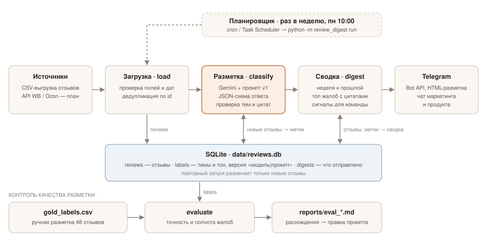

# Что говорят покупатели — AI-сводка отзывов в Telegram

Раз в неделю скрипт забирает свежие отзывы, раскладывает их через Gemini по темам и тону и присылает в Telegram-чат сводку: сколько упоминаний по каждой теме, топ жалоб с цитатами, что изменилось к прошлой неделе и на что обратить внимание.



## Запуск за 10 минут

Нужен Python 3.10+.

```bash
git clone <repo> && cd luxhomme-reviews
python -m venv .venv
.venv\Scripts\activate            # Linux/macOS: source .venv/bin/activate
pip install -r requirements.txt
copy .env.example .env            # Linux/macOS: cp .env.example .env
```

В `.env` впишите:

- `GEMINI_API_KEY` — бесплатный ключ из [Google AI Studio](https://aistudio.google.com/apikey);
- `TELEGRAM_BOT_TOKEN` — токен от [@BotFather](https://t.me/BotFather) (`/newbot`);
- `TELEGRAM_CHAT_ID` — добавьте бота в чат, напишите туда что-нибудь и найдите `chat.id` в `https://api.telegram.org/bot<TOKEN>/getUpdates`.

Запуск всей цепочки: CSV → база → разметка → сводка в Telegram.

```bash
python -m review_digest run
```

Посмотреть сводку в консоли, ничего не отправляя: `python -m review_digest run --dry-run`.

### Команды

| Команда | Что делает |
|---|---|
| `run [--csv путь] [--as-of 2026-10-24] [--dry-run]` | всё сразу |
| `load --csv путь` | загрузить отзывы в SQLite, повторные пропускаются |
| `classify` | разметить через Gemini только новые отзывы |
| `digest [--as-of дата] [--dry-run]` | собрать сводку за 7 дней до `--as-of` и отправить |
| `evaluate` | сверить разметку модели с ручной и сохранить отчёт в `reports/` |

Неделя — 7 дней, которые заканчиваются датой `--as-of` (по умолчанию дата самого свежего отзыва в базе). Для еженедельной отправки достаточно поставить `run` в cron или Планировщик заданий Windows на понедельник утром.

Тесты (без сети и ключей): `pip install -r requirements-dev.txt && pytest`.

## Как устроено

| Файл | Зачем |
|---|---|
| [data/reviews.csv](data/reviews.csv) | 48 тестовых отзывов за две недели по четырём SKU |
| [data/gold_labels.csv](data/gold_labels.csv) | моя ручная разметка тех же отзывов — эталон для проверки |
| [prompts/classify_v1.md](prompts/classify_v1.md) | промпт разметки |
| [review_digest/taxonomy.py](review_digest/taxonomy.py) | справочник тем |
| [review_digest/classifier.py](review_digest/classifier.py) | вызов Gemini и проверка ответа |
| [review_digest/digest.py](review_digest/digest.py) | подсчёты и текст сводки |
| [review_digest/evaluate.py](review_digest/evaluate.py) | метрики качества разметки |

**Темы — фиксированный справочник из 12 тем**, а не свободные теги от модели. Свободные темы удобны на первом прогоне, но неделя к неделе модель называет одно и то же по-разному («долгая доставка», «сроки доставки»), и сравнивать нечего. Если модель всё чаще ставит `other`, сводка об этом пишет — значит, пора добавлять тему.

**Тон ставится по каждой теме отдельно**, а не на отзыв целиком. «Кофе вкусный, но доставка 9 дней» — это одновременно похвала продукту и жалоба на логистику. Если поставить отзыву один ярлык «смешанный», жалоба на доставку потеряется.

**Звёзды модели не передаются.** Тон определяется только по тексту, поэтому видно, когда текст и оценка расходятся: например, 7 отзывов на ★1–3 на тестовой неделе ругают только доставку, а к самому товару претензий нет.

**Ответу модели не верим на слово.** Gemini отвечает по JSON-схеме, после чего код проверяет каждую запись: известен ли `review_id`, есть ли тема в справочнике, встречается ли цитата в тексте отзыва. Цитату, которой нет в отзыве, в сводку не берём. Отзывы, которые модель пропустила, переспрашиваем по одному, сбои API повторяем с паузой. Неразобранные отзывы показываются в сводке отдельной строкой, а не теряются молча.

**Разметка хранится с версией «модель|промпт».** Повторный запуск не тратит запросы на уже размеченные отзывы, а смена модели или промпта даёт новую разметку рядом со старой — их можно сравнить на эталоне.

Ключи лежат только в `.env`, он в `.gitignore`. Ошибки Telegram выводятся без URL, потому что в URL запроса зашит токен.

## Разбор

### Как проверял, что AI не ошибается в темах

1. Разметил все 48 отзывов вручную ([data/gold_labels.csv](data/gold_labels.csv)), включая трудные случаи: сарказм («ну да, конечно, доставка за 3 дня»), отзывы без конкретики («Нормально»), повреждение при доставке, где непонятно, это доставка или упаковка, и сбой прошивки, из-за которого пылесос хуже убирает.
2. `python -m review_digest evaluate` сравнивает разметку модели с эталоном. Главная метрика — точность и полнота **жалоб** (пара «отзыв + тема с негативом»): именно они попадают в топ сводки. Отдельно считаются темы, тон, общий тон отзыва и доля цитат, найденных в тексте.
3. По таблице расхождений правил промпт и решал, где ошибается модель, а где мой эталон.

Результат на `gemini-3.6-flash`, промпт v1: **<!-- TODO: цифры из reports/eval_*.md после прогона -->**. Полный отчёт с расхождениями — [reports/](reports/).

Примеры из промпта (блендер, утюг, мультиварка) специально не взяты из тестовых данных, иначе проверка была бы нечестной. Честно о пределах: эталон размечал один человек, а 48 отзывов — маленькая выборка, так что метрики ориентировочные.

### Что сделал бы иначе в продакшене

- **Источник** — API маркетплейсов вместо CSV: Wildberries (Feedbacks API) и Ozon Seller API. Забирать раз в сутки, хранить курсор по дате последнего отзыва.
- **Хранилище** — Postgres или корпоративное DWH вместо SQLite, отдельная таблица аспектов, чтобы строить дашборд в BI.
- **Объём.** На десятках тысяч отзывов — Batch API Gemini (дешевле и без лимитов на частоту), а первичную разметку старой базы делать один раз.
- **Качество.** Эталон из 200–300 отзывов, размеченный двумя людьми, с оценкой их согласия. Каждую неделю 20 случайных отзывов отдавать на ручную проверку и следить за метриками. При смене модели или промпта запускать `evaluate` до выката.
- **Темы.** Раз в квартал прогонять кластеризацию по отзывам из `other` и решать, нужны ли новые темы.
- **Надёжность.** Алерт в отдельный чат, если пайплайн упал или разобрано меньше 95 % отзывов. Ключи — в секрет-хранилище.
- **Сводка.** Добавить разбивку по маркетплейсам и ссылки на сами отзывы, а при резком всплеске жалоб присылать сообщение сразу, не дожидаясь понедельника.

### Вопросы маркетингу до старта

1. Что вы сделаете, прочитав сводку? От этого зависит, нужна ли разбивка по SKU, по маркетплейсам, по партиям.
2. Какие темы для вас важны? Справочник я придумал сам, его нужно сверить с вашими категориями — возможно, они уже есть в CRM или у поддержки.
3. Сколько SKU и маркетплейсов, сколько отзывов в неделю? Отсюда выбор между обычным и пакетным API и стоимость.
4. Кто получает сводку и в каком виде: один общий чат или отдельные сообщения продукту, логистике, поддержке?
5. Что считать тревогой, о которой надо сообщить сразу: всплеск жалоб на брак, падение рейтинга SKU ниже 4,5?
6. Отвечаете ли вы на отзывы? Тот же разбор может готовить черновики ответов.
7. Есть ли у вас уже размеченные отзывы (например, тикеты поддержки по категориям)? Это готовый эталон для проверки.

## Сверх задания

- Блок «Обратить внимание» в сводке: низкие оценки, в которых виновата логистика, а не товар; главная претензия по каждому SKU; отзывы, где оценка противоречит тексту; темы вне справочника.
- Проверка, что цитаты действительно есть в отзыве: в сводку не попадает то, чего покупатель не писал.
- Повторные запуски бесплатны, разметка версионируется.
